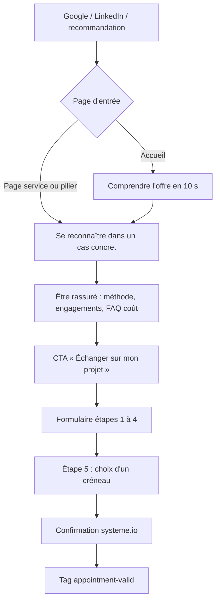
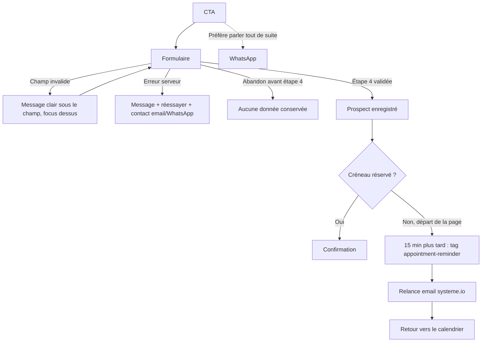
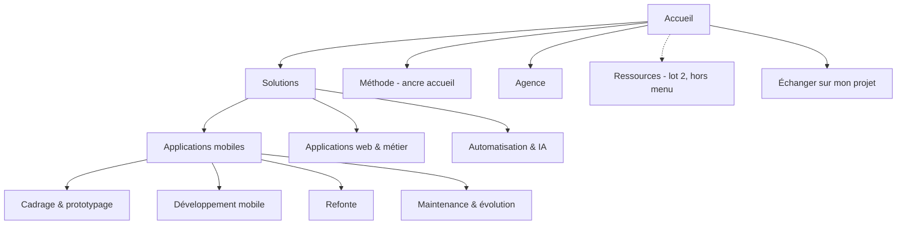

# B2 — Utilisateurs et parcours — Refonte du site Synumanus

Version 1.0 — 17/11/2026 — **validée par TawfiqDev** (arbitrages §6)
Personas construits à partir de la stratégie (Organisation V2) — **hypothèses non vérifiées par entretien** (aucune donnée utilisateur réelle).

## 1. Personas

### P1 — Karim, gérant d'une entreprise de BTP (12 salariés) — primaire
- **Objectif :** arrêter les bons d'intervention papier et les photos WhatsApp perdues ; savoir en temps réel où en sont ses chantiers.
- **Frustrations :** logiciels du marché trop génériques ou trop chers ; peur de payer un projet informatique qui n'aboutit pas ; jargon.
- **Contexte :** consulte le site sur smartphone, entre deux chantiers, souvent en extérieur (luminosité forte). Peu de temps.
- **Ce qui le décide :** un exemple qui ressemble à son métier, un interlocuteur unique, savoir combien de temps ça prend.
- **Accessibilité :** maîtrise numérique moyenne, lecture rapide, presbytie possible → textes courts, taille ≥ 16 px, cibles tactiles ≥ 44 px.

### P2 — Sophie, directrice d'un organisme de formation (30 personnes) — primaire
- **Objectif :** automatiser inscriptions, émargement et suivi des stagiaires ; gagner du temps administratif.
- **Frustrations :** outils empilés qui ne se parlent pas ; doubles saisies ; prestataires qui disparaissent après livraison.
- **Contexte :** desktop au bureau, compare 2 à 3 prestataires, partage le lien à son associé.
- **Ce qui la décide :** méthode claire, maintenance garantie, compréhension de ses process (pilier Web & métier / Automatisation).
- **Accessibilité :** à l'aise sur ordinateur, lit en détail → FAQ, méthode, engagements.

### P3 — Julien, responsable produit dans une PME qui a déjà une app — secondaire
- **Objectif :** faire reprendre une application vieillissante (bugs, mises à jour stores, dette technique) ou trouver une TMA fiable.
- **Frustrations :** ancien prestataire indisponible ; code qu'il ne maîtrise pas ; peur de tout réécrire.
- **Contexte :** desktop, vocabulaire technique, va directement aux services Refonte / Maintenance.
- **Ce qui le décide :** expertise technique crédible (Kotlin, Swift, Flutter), audit avant décision, cadre TMA clair.

## 2. Parcours de conversion — nominal

## 3. Parcours alternatifs et d'erreur

## 4. Arborescence cible

**Navigation principale au MVP** : Solutions ▾ · Méthode (ancre) · Agence · bouton « Échanger sur mon projet ». « Ressources ▾ » sera ajouté avec le lot 2 (5 entrées max).
Footer : piliers, services, cas d'usage, ressources, légal, contact, newsletter.
« Réalisations » : prévue dans l'arborescence, **non publiée** avant les futures apps Synumanus.

## 5. Correspondance des URLs

| URL actuelle | Devenir | Lot | Action |
|---|---|---|---|
| `/` | Accueil refondue | MVP | Conservée |
| — | `/applications-mobiles/` (pilier) | MVP | Nouvelle |
| — | `/applications-web-metier/` (pilier) | MVP | Nouvelle |
| — | `/automatisation-ia/` (pilier) | MVP | Nouvelle |
| — | `/#methode` (section de l'accueil) | MVP | Ancre |
| `/services/cadrage-prototypage/` | Service mobile | MVP | Conservée |
| `/services/developpement-application-mobile/` | Service mobile | MVP | Conservée |
| `/services/refonte-application-mobile/` | Service mobile | MVP | Conservée |
| `/services/maintenance-evolution/` | Service mobile | MVP | Conservée |
| `/a-propos/agence/` | Agence | MVP | Conservée |
| `/demarrer-un-projet/` | Formulaire + calendrier | MVP | Conservée |
| `/mentions-legales/`, `/politique-confidentialite/` | Légal | MVP | Conservées (à compléter) |
| `/secteurs/industrie/`, `/secteurs/finance-assurance/`, `/secteurs/sante/` | Cas d'usage (libellé changé, URL inchangée) | Lot 2 | Conservées ; ancien design jusqu'au lot 2 |
| `/conseil-ia-generative/` | Rattachée au pilier Automatisation & IA | Lot 2 | Conservée |
| `/ressources/generateur-cahier-des-charges/`, `/ressources/radars-tech/`, `/actus/` | Ressources | Lot 2 | Conservées |

**Résultat : aucune redirection 301 nécessaire au MVP** (seulement des ajouts). Les pages du lot 2 restent en ligne avec l'ancien design pendant la transition — **risque d'incohérence visuelle temporaire** (voir questions).

## 6. Arbitrages (17/11/2026, TawfiqDev)
1. Pages du lot 2 pendant la transition : **retirées de la navigation**, URLs conservées et accessibles (pas de 301, pas de perte SEO). Liens maintenus dans le footer et le sitemap.
2. « Méthode » : **section de l'accueil** avec ancre `/#methode` (pas de page dédiée). Le tableau §5 est mis à jour en conséquence.
3. Formulaire : **variante en 4 étapes à explorer en B3** (fusion projet + besoin métier), à mesurer avant/après avec Plausible.
