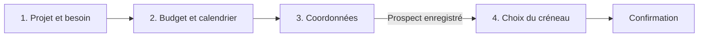

# B3 — Wireframes — Refonte du site Synumanus

Version 0.2 — 17/11/2026 — **en attente de validation TawfiqDev (⛔)**
Entrées : B1 v1.0, B2 v1.0, journal des décisions, specs v0.1 (tokens proposés).
Wireframes **textuels** (zones dans l'ordre mobile, de haut en bas). Desktop = même ordre, mise en colonnes indiquée. Contenus d'exemple **fictifs**.

---

## 0. Éléments communs

### 0.1 Header (toutes pages)
| Zone | Contenu | Action | Mobile | Desktop |
|---|---|---|---|---|
| Logo | Logo Synumanus | Lien vers `/` | À gauche | À gauche |
| Navigation | Solutions ▾ · Méthode · Agence | Solutions ouvre un sous-menu à 3 colonnes (piliers + services mobiles) | Bouton menu 44 px → panneau plein écran | Barre flottante bordée, 10 px de rayon |
| CTA | « Échanger sur mon projet » | Vers `/demarrer-un-projet/` | Dans le panneau, en bas, pleine largeur | Bouton clair à droite |

États : sous-menu ouvert/fermé (Échap ferme, focus rendu au déclencheur) ; page courante signalée par `aria-current` + soulignement (pas seulement la couleur) ; header compact au défilement (hauteur 64 → 56 px), jamais masqué.

### 0.2 Footer (toutes pages)
4 colonnes desktop / accordéons non utilisés en mobile (liste simple, plus lisible) : **Solutions** (3 piliers + 4 services) · **Cas d'usage** (industrie, finance-assurance, santé — lot 2, liens maintenus) · **Ressources** (générateur, radars, actus — lot 2) · **Contact** (email, WhatsApp, newsletter). Ligne basse : mentions légales, confidentialité, © Synumanus.
Newsletter : champ email + bouton « S'inscrire » ; états succès / email invalide / déjà inscrit / erreur serveur (logique PHP existante conservée).

### 0.3 Bouton WhatsApp flottant
56 px, bas droite, au-dessus de tout sauf du panneau de menu. Masqué sur `/demarrer-un-projet/` pendant la saisie (étapes 1 à 3) pour ne pas couvrir le bouton « Continuer » — **validé TawfiqDev le 17/11**. Réaffiché à l'étape 4 (créneau) et en cas d'erreur serveur ; le lien WhatsApp reste présent dans les messages d'erreur. Libellé accessible : « Discuter sur WhatsApp (nouvelle fenêtre) ».

### 0.4 Bloc CTA de fin de page (réutilisable)
Titre « Parlons de votre projet » · réassurance « Premier échange de 30 min, gratuit et sans engagement » · bouton clair « Échanger sur mon projet » · lien secondaire « Ou écrivez-nous sur WhatsApp ».

---

## 1. Accueil `/`
**Objectif :** comprendre l'offre en 10 s, se reconnaître dans un cas, demander un échange.

| # | Section | Contenu (fictif) | Hiérarchie / actions | Desktop |
|---|---|---|---|---|
| 1 | Hero | Sur-titre « Applications sur mesure » · H1 « Des applications pensées pour **votre métier** » · chapeau bénéfice (2 lignes max) · CTA clair + lien « Voir la méthode » (ancre) · aperçu d'app fictive encadré (mention « exemple d'interface ») | CTA principal visible sans défilement sur mobile 375 × 667 | Texte 6 col. / aperçu 6 col. |
| 2 | Pour qui | 3 à 4 situations concrètes : « Vos bons d'intervention sont encore sur papier », « Vos équipes ressaisissent les mêmes données », « Votre application vieillit »… → chaque carte renvoie au pilier/service adapté | Cartes bordées cliquables entièrement | Grille 2 × 2 |
| 3 | 3 piliers | Applications mobiles (badge « expertise phare ») · Applications web & métier · Automatisation & IA — titre, 1 phrase, 3 exemples, lien | Mobile mis en avant (carte large) | 1 large + 2 |
| 4 | Méthode `#methode` | 4 étapes : Échange gratuit → Cadrage → Développement par Sprints de 2 semaines → Mise en ligne et suivi ; durée type d'une V1 indiquée en fourchette | Liste ordonnée `<ol>` | Frise horizontale |
| 5 | Engagements | Interlocuteur unique · Code et données vous appartiennent · Accessibilité incluse · Maintenance après livraison | 4 tuiles courtes | 4 colonnes |
| 6 | FAQ | « Combien coûte une application ? » (facteurs de coût, devis après cadrage, pas de prix) · « Combien de temps ? » · « Je n'y connais rien en technique » · « Que se passe-t-il après la livraison ? » | Accordéons, 1 ouvert par défaut | 2 colonnes : titre / liste |
| 7 | CTA de fin | Bloc 0.4 | — | — |

**Réalisations :** aucune section au lancement (décision du 16/11).

---

## 2. Gabarit pilier — ex. `/applications-mobiles/`
**Objectif :** confirmer que Synumanus traite mon cas et m'orienter vers le bon service.

| # | Section | Contenu |
|---|---|---|
| 1 | Fil d'Ariane | Accueil › Solutions › Applications mobiles |
| 2 | Hero | H1 du pilier + chapeau + CTA + aperçu d'app encadré |
| 3 | Problèmes résolus | 3 à 4 cartes « situation → résultat » |
| 4 | Services du pilier | Mobile : 4 cartes (Cadrage, Développement, Refonte, Maintenance) avec « pour qui » + lien. Web & métier et Automatisation : 2 à 3 blocs descriptifs (pas de sous-pages au MVP) |
| 5 | Technologies (sobre) | Flutter, Kotlin, Swift… avec une phrase de bénéfice chacune, pas de logos seuls |
| 6 | FAQ du pilier | 3 à 4 questions |
| 7 | CTA de fin | Bloc 0.4 |

---

## 3. Gabarit service — ex. `/services/cadrage-prototypage/`
**Objectif :** comprendre ce que je reçois, comment, et passer à l'action.

| # | Section | Contenu |
|---|---|---|
| 1 | Fil d'Ariane | Accueil › Applications mobiles › Cadrage & prototypage |
| 2 | Hero (décision du 17/11, option B) | Fond `#0a0a0a`, H1 à gauche (60/40 px, mot en bleu), chapeau, CTA, **aperçu d'app fictive propre au service** à droite (mobile : sous le CTA, réduit) ; 3 preuves courtes sous le CTA |
| 3 | Pour qui / quand | 3 situations déclencheuses |
| 4 | Ce que vous recevez | Livrables concrets en cartes |
| 5 | Déroulé | Étapes numérotées + durée type |
| 6 | Pourquoi Synumanus | 3 arguments (pas de témoignage au lancement) |
| 7 | FAQ | 3 à 5 questions |
| 8 | Services liés | 2 cartes vers les services voisins |
| 9 | CTA de fin | Bloc 0.4 |

Aperçus par service : Cadrage = parcours + prototype · Développement = bon d'intervention BTP · Refonte = avant / après · Maintenance = suivi des demandes et versions.

---

## 4. Agence `/a-propos/agence/`
Voix « je ». Hero avec **la seule photo du site** (réelle, TawfiqDev ou espace de travail — à fournir) · parcours (10 ans d'expérience) · façon de travailler (équipe outillée, Sprints, interlocuteur unique) · valeurs (simplicité, accessibilité, transparence) · CTA.

---

## 5. Démarrer un projet `/demarrer-un-projet/` — variante 4 étapes (à mesurer)

| Étape | Contenu | Validation |
|---|---|---|
| 1. Projet et besoin (fusion des étapes 1 + 2 actuelles) | Nature du projet (cartes radio) — **à élargir aux 3 piliers** : Nouvelle application mobile · Application web / métier · Automatisation ou IA · Refonte / reprise · Évolution · Je ne sais pas encore ; Où en êtes-vous (pastilles) ; Problème à résoudre (zone de texte, 1 800 caractères, compteur) | Nature et maturité obligatoires ; texte ≥ 20 caractères |
| 2. Budget et calendrier | Fourchette de budget (cartes, conservées) + aide « Pas sûr ? Choisissez une fourchette large, on affinera ensemble » ; démarrage souhaité ; échéance (facultative) | Budget obligatoire |
| 3. Coordonnées | Entreprise (facultatif), Nom, Prénom, Email, Téléphone ; mention d'information RGPD sous le bouton | Formats email / téléphone FR ; validation à la sortie du champ |
| 4. Créneau | Calendrier systeme.io intégré ; lien de secours « Je préfère être rappelé » | — |

**Commun aux étapes :** indicateur « Étape X sur 4 » + titre de l'étape (texte, pas seulement une barre) ; boutons « Retour » (secondaire) et « Continuer » (clair) en bas, pleine largeur sur mobile ; données conservées en cas de retour arrière ; focus placé sur le titre de l'étape à chaque changement, annoncé aux lecteurs d'écran.

### États et cas limites (formulaire)
| Cas | Comportement attendu |
|---|---|
| Champ invalide | Message sous le champ (icône + texte), `aria-invalid`, focus sur le premier champ en erreur ; ex. « Indiquez un email valide, par exemple nom@entreprise.fr » |
| Erreur serveur à l'envoi (étape 3) | Bandeau : « L'envoi n'a pas abouti. Vos réponses sont conservées. Réessayez ou écrivez-nous sur WhatsApp. » + bouton « Réessayer » |
| Hors ligne | Même bandeau, réessai possible au retour du réseau |
| Envoi en cours | Bouton désactivé + « Envoi en cours… » annoncé |
| Calendrier qui ne charge pas | Message + lien direct vers le calendrier + WhatsApp |
| Abandon avant l'étape 3 | Rien n'est conservé (décision B2) |
| Abandon à l'étape 4 | Relance systeme.io après 15 min (logique existante) |
| Texte long / zoom 200 % / 320 px de large | Aucun défilement horizontal ; cartes radio passent en 1 colonne |

---

## 6. Pages légales
Gabarit texte simple : H1, date de mise à jour, sommaire ancré, contenu en 16 px / 1,6, largeur de lecture ≤ 72 caractères.

---

## 7. États génériques (toutes pages)
| État | Traitement |
|---|---|
| Chargement | Pas de squelette (site statique) ; images avec dimensions fixées pour éviter les décalages (CLS < 0,1) |
| Image d'aperçu absente | Le cadre reste, fond `#171717`, aucun texte perdu (l'aperçu est décoratif) |
| Animations | Apparitions courtes (≤ 300 ms) ; **aucune** si `prefers-reduced-motion` ; le contenu du hero n'attend jamais une animation pour être visible |
| 404 | Page sobre : « Cette page n'existe pas ou a été déplacée » + liens Accueil, Solutions, Échanger sur mon projet |

---

## 8. Hypothèses et risques
- Fusionner projet + besoin rend l'étape 1 plus longue : à surveiller (abandon à l'étape 1). Mesure avant/après avec Plausible.
- Les nouvelles valeurs de « Nature du projet » doivent être acceptées par le back-end PHP, dont la refonte est exclue → **question pour Law**.
- La photo de la page Agence est à fournir par TawfiqDev.

## 9. Questions ouvertes
| # | Question | Pour |
|---|---|---|
| 1 | Le PHP accepte-t-il de nouvelles valeurs pour `Nature du projet` sans modification ? Le passage de 5 à 4 étapes casse-t-il le suivi d'étapes ou la relance systeme.io ? | Law |
| 2 | Une mention d'information RGPD existe-t-elle sur le formulaire actuel ? (non trouvée dans le HTML) | Law, TawfiqDev |
| 3 | ~~Masquer le bouton WhatsApp sur le formulaire~~ — validé le 17/11 | — |
| 4 | Fourchettes de budget : les garder telles quelles ? (ce ne sont pas des prix affichés, mais elles donnent un ordre de grandeur) | TawfiqDev |
